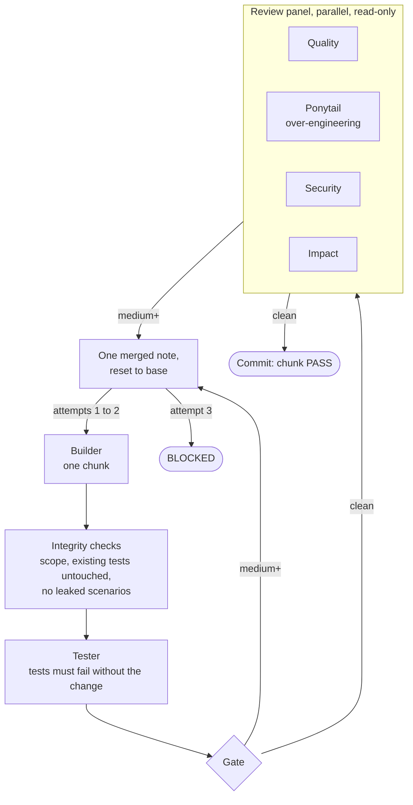

# Dark Factory

Give it a bug report, feature request, PRD or an idea. It asks only what the repo can't
answer, you sign off once, then a team of subagents builds, tests and QAs in a loop with nobody
in the middle. You get a git branch and a report, and at the end it asks whether to push the branch and
open a PR. It pushes only on a yes, and it never merges.

Claude Code plugin. v0.2, open source. macOS, Linux, WSL.

## Install

```bash
claude plugin marketplace add Hafiz408/dark-factory
claude plugin install dark-factory@dark-factory --scope project
```

Try without installing: clone the repo, then `claude --plugin-dir ./dark-factory`.

## Use

```
/dark-factory <idea, PRD, ticket text, bug report, or a path>
/dark-factory list | status [run-id] | resume [run-id] | clean <run-id> | sweep
```

It first confirms the base branch ("ok" keeps the one you are on). You then answer one batch of
questions (at most 8, each with a default) and approve once, on a sign-off screen that shows the
approach, the alternatives considered, the trade-offs and the to-do list. After that you see one
line per milestone, `[df <run-id>] <stage>: <event>`. `resume` works from a new session: all
state is on disk.

## What you get

- **Routed work.** `bugfix`, `feature` or `build` is picked for you and changes how it plans.
- **A branch** (`df/<run-id>`, or the name you give) in a separate git worktree, one commit per passing chunk.
- **`report.md`:** functional changes first, then high-level technical changes, then what was
  left (with severity), assumptions, and one plain line saying whether the branch is green. A bugfix that changed no source says **NOT FIXED**.
- **Review before QA.** Four read-only review lenses per chunk (quality, over-engineering,
  security, impact), then a whole-branch review that also checks the goal was met. Medium or
  above blocks. Hidden QA scenarios run only once that review is clean.
- **End-to-end check.** Each repo gets a profile beside the clone (`../.df-<repo>/profile.md`,
  never committed) naming its e2e command and how to start the app. After QA the run checks
  that nothing which passed before now fails. Without one, the report says "e2e: not
  configured".
- **Parallel builders, opt-in.** With `parallel=on`, chunks that touch disjoint files build at
  the same time in their own sub-worktrees and are cherry-picked back in order. Off by default.
- **It learns per repo.** After each run a retro writes facts about the repo that would have
  saved an attempt (`../.df-<repo>/lessons.md`, at most 30 lines, fed to later runs) and
  suggestions for the plugin itself (`proposals.md`, never applied for you). `metrics.tsv`
  keeps one row per run so you can see whether attempts go down.
- **A run that cannot get clean pauses.** It tells you what is open and never reports a pass.
- **Resume** after a crash, closed laptop or expired login, losing at most one attempt.
- **A PR on request.** A run that came through QA and e2e asks "Push and open a PR?"; only "yes"
  does it (needs `gh`, signed in). `sweep` offers to remove the worktree and local branch once
  that PR is merged. It never merges, never force-pushes, and never deletes a remote branch.

## How it works

```mermaid
flowchart LR
    A([Your request]) --> R[Route]
    R --> F[Refine<br/>gap questions]
    F --> P[Plan<br/>chunks + hidden QA scenarios]
    P --> PF[Preflight<br/>deps, commands, baseline]
    PF --> S{{Sign-off}}
    S --> L[[Loop per chunk]]
    L --> I[Review<br/>whole branch, until clean]
    I --> QA[QA<br/>hidden scenarios]
    QA -->|fails| I
    QA --> E[E2E<br/>repo's own suite vs baseline]
    E -->|new failure| I
    E --> SH{{Push + PR?}}
    SH --> O([Branch + report, PR on yes])

    classDef you fill:#fde68a,stroke:#b45309,color:#000
    class F,S,SH you
```



Yellow is where you are asked something. Everything after sign-off is unattended.

Each chunk gets up to three attempts:



- The planner and the QA author work from the spec independently, so the tests can't be shaped
  by the implementation.
- The orchestrator keeps nothing in memory. Run state lives in `../.df-<repo>/<run-id>/`.
- A guard hook blocks `git push`, deletes outside the worktree and pipe-to-shell during a run.
  A seat belt, not a sandbox.

## Evidence

Run on eight real codebases (nine issues) plus two specs built from scratch, across Python, JavaScript, Go and
Rust (3k to 98k lines; bug, feature and build tracks), each graded by a hidden test the factory
never saw. One run each; one task did not finish. Every failure
and what changed because of it is in `docs/evaluation.md` and `docs/field-test.md`.

No guarantee of correct output, no sandbox, prompt injection mitigated and not solved, native
Windows unsupported, each live scenario run once, token cost not measured.

## Development

```bash
bash tests/run.sh
```

Design: `docs/design.md`. Product name is decided before this goes public.
