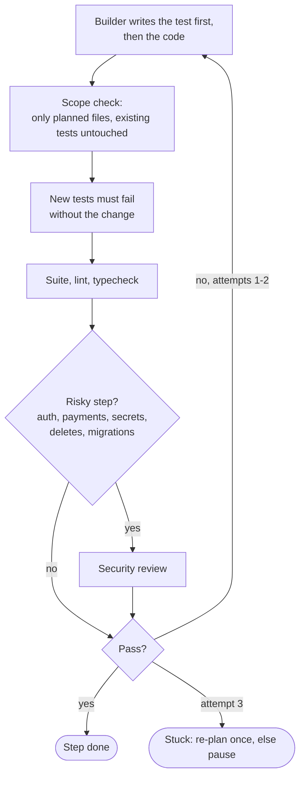

# Dark Factory

**It asks the questions Claude would otherwise silently assume, you approve once, and it builds,
checks, merges and re-tests the work without you watching.**

Give it a bug report, a feature request, a PRD or a plain idea. You answer a few questions
(each has a default), approve one screen, and walk away. You come back to merged, tested code
and a short note in plain words saying what changed and how it was checked.

Claude Code plugin. v0.3, open source, MIT. macOS, Linux, WSL.

> **When not to use it**
> - A one-line fix or a quick question: just ask Claude. It is faster and cheaper.
> - You want to steer every step as it happens. Dark Factory asks everything up front, then works alone.
> - You need a sandbox. It runs with your permissions; the guard hook is a seat belt, not a cage.
> - Native Windows (use WSL).

## Quickstart

```bash
claude plugin marketplace add Hafiz408/dark-factory
claude plugin install dark-factory@dark-factory --scope project
```

Then, inside your project (or an empty folder, to build something new):

```
> /dark-factory:dark-factory Add a --json flag to the export command
```

1. Say `ok` to the starting branch, then answer the questions (`ok` takes every default).
2. Read the sign-off screen and say `approve`. It shows an estimate such as
   `estimate: 7-14 min, ~6-8 agents`: a rough range, not a promise, and a cap the run will not
   exceed. Stay a moment: commands it will run may ask for permission now, so nothing stalls later.
3. Leave it, usually for minutes, not hours. It prints one line per milestone, like
   `[df r261127-101500-123] step 2 of 4 done`.
4. It works in a sibling folder (`../<repo>-df-<run-id>`), so your own checkout is untouched
   until the merge. At the end you get a plain note: what changed, how it was checked, and
   where it is now (merged, or a PR link, or a branch).

Try it without installing: clone this repo, then `claude --plugin-dir ./dark-factory`.

## How it works


Yellow is where you are asked something. Nothing is asked after sign-off, except when a
command needs your permission or a budget cap is hit.

- **Questions.** One refiner reads your request and the repo, and asks at most 8 questions.
  After your answers it writes the spec.
- **Plan and hidden checks.** A planner splits the work into steps; separately, a QA author
  writes test scenarios the builder never sees, so the tests can't be shaped by the code.
- **Build.** Steps that touch different files and don't depend on each other run side by side
  (up to 3 lanes). Each lane has one builder that keeps its context across steps and fixes.
  Each step must pass mechanical checks before it counts:



- **Checker.** One fresh agent reviews the whole change (goal met, correctness, impact on
  existing code, security, over-engineering) and runs every hidden check. A serious finding
  must come with evidence (a failing command, a failing check, or a line plus an input that
  breaks it); one without evidence does not block. Findings go back to the builder that
  wrote the code; at most 2 fix rounds, then it pauses.
- **Ending.** It writes `report.md`, opens a PR, merges it once the PR's checks pass, then
  tests again on the merged code.

## Ship modes

Chosen on the sign-off screen, so the rest runs unattended.

| You say | With GitHub (`origin` + `gh auth`) | Without GitHub |
|---|---|---|
| `approve` (default: merge) | Opens a PR, waits for its checks (up to 20 min), merges (squash if allowed), re-tests the merged code | Merges into your branch on this computer, then re-tests |
| `approve, no merge` | Opens the PR and stops | Leaves the work on its branch |
| `approve, local` | Merges on this computer only, never pushes | Same |

It never force-pushes, never uses `--admin`, and never merges red: failing or slow checks
leave the PR open and say why. A local merge happens only when your folder is clean and on
the target branch (fast-forward only); otherwise the work stays on its branch with one line
saying how to bring it in. If the re-test after merging fails, the note says so first and
offers `revert` (opens a revert PR) or `undo` (moves a local merge back).

## Budget cap

The sign-off screen shows a rough estimate (`estimate: 7-14 min, ~6-8 agents`) and a cap
(`cap: up to 12 agents and 21 min`), by default 1.5x the high end. Past either, the run pauses
instead of spending more. Raise it with
`scripts/df conf-set <state-dir>/run.conf max_agents <n>` (or `budget_seconds`, or
`max_review_rounds`) and `resume`. Estimates start from default figures and use this repo's
past runs once there are a few.

## Status, resume, cleanup

```
/dark-factory:dark-factory status [run-id]    where a run is ("not running" if its session died)
/dark-factory:dark-factory resume [run-id]    continue after a crash, closed laptop or expired login
/dark-factory:dark-factory list | sweep | clean <run-id>
```

- Work happens in a separate copy beside your repo, `../<repo>-df-<run-id>`. Your own folder
  is not touched, except by a local merge you approved.
- Run state lives in `../.df-<repo>/<run-id>/`, never committed. One run executes per repo at
  a time. `resume` works from a new session: everything is on disk.
- After a merge that re-tests green, it removes the working copy and local branch by itself
  and keeps the report in `../.df-<repo>/reports/<run-id>.md`. `sweep` offers the same cleanup
  for runs whose PR merged later; `clean` removes a run's working copy and state but keeps
  its branch.
- After a run with a retry, a fix round or a pause, a short retro writes repo facts to
  `../.df-<repo>/lessons.md` (used by later runs) and suggestions for the plugin (shown to
  you, never applied).
- A guard hook blocks `git push`, recursive deletes outside the run's copy, pipe-to-shell and
  migrations against real databases while a run is live.

## Results, honestly

Same tasks, same evaluators, compared with asking plain Claude Code directly. Score is the
evaluators' overall rating out of 10.

| Task | Dark Factory | Plain Claude | Score |
|---|---|---|---|
| Bugfix (real library issue) | v0.2: 22 min, 32 agents, ~1M tokens | 3 min | 3/10 |
| Feature (small app) | v0.2: 62 min, 76 agents, ~2.7M tokens | 4 min | 4/10 |
| Newcomer (non-technical user, new tool) | v0.2: 47 min, 78 agents, ~2.4M tokens | 77 s | 4/10 |
| All three | **v0.3: re-evaluation pending** | | |

v0.2 got the right answer but cost far more than plain Claude for near-identical results.
v0.3 is the response: one checker instead of review panels, mechanical checks instead of an
agent per step, resumed builders, parallel lanes, and the full PR, merge and re-test cycle.
Its numbers replace that row once measured. Earlier field runs: `docs/evaluation.md`,
`docs/field-test.md`.

No guarantee of correct output, no sandbox, prompt injection mitigated and not solved.

## Development

```bash
bash tests/run.sh
```

Design: `docs/design.md`.
