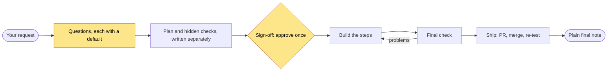
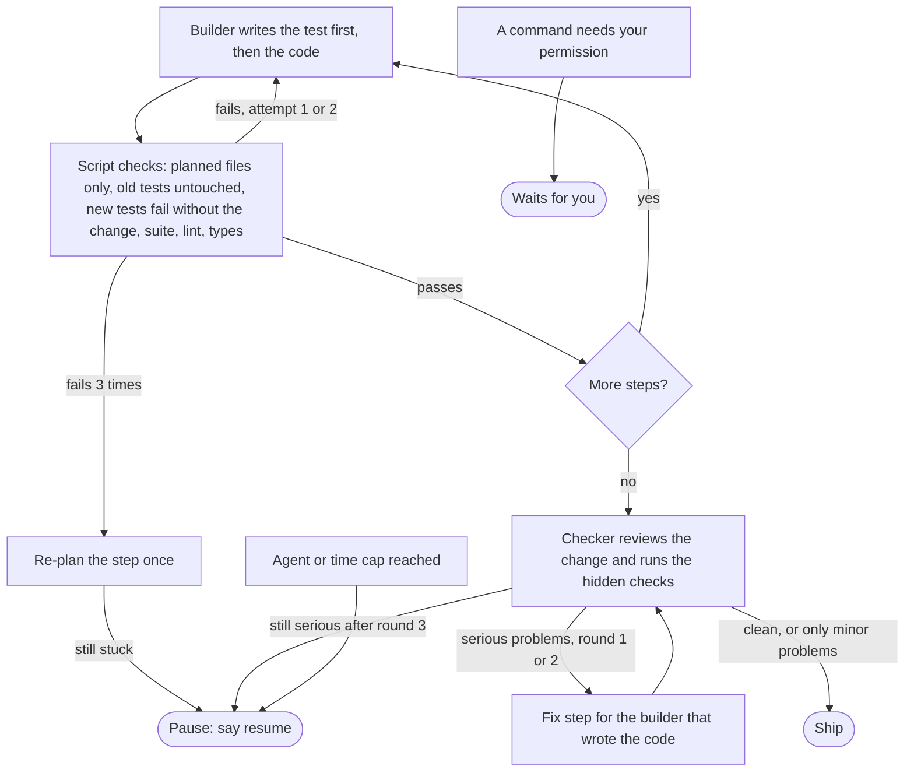
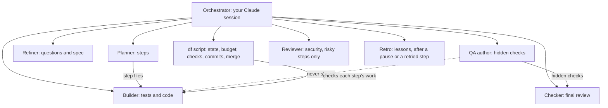
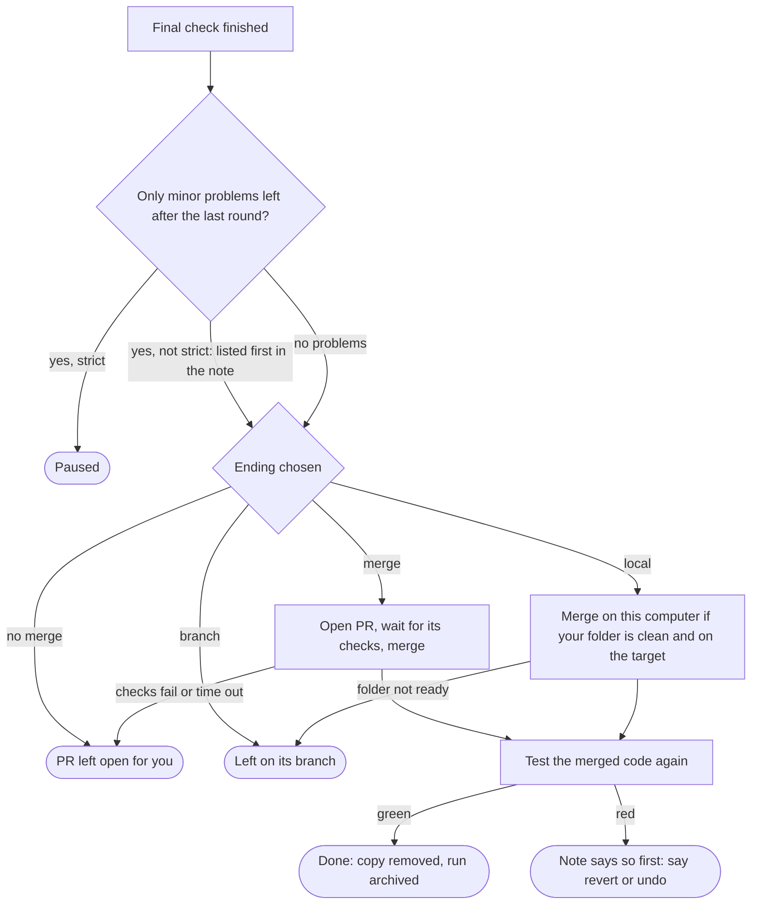

# Dark Factory

**Tell it what you want, answer a few questions, approve once, and walk away: it builds,
checks, merges and re-tests the work, then tells you in plain words what changed.**

A Claude Code plugin. v0.3, open source, MIT. macOS, Linux, WSL.

**Use it when** you have a bug report, a feature request, a PRD or a plain idea, you can say up
front what "done" means, and you would rather not watch every step.

**Don't use it when**
- the task is a one-line fix or a quick question: plain Claude is faster and cheaper;
- you want to steer each step as it happens: Dark Factory asks everything first, then works alone;
- you need a sandbox: it runs with your permissions (see Safety);
- you are on native Windows (use WSL).

## Before you start

You need:
- **Claude Code**, signed in (`claude` works in a terminal).
- **git**. An empty folder is fine: it can start a new git repository there.
- **gh** (the GitHub command-line tool), signed in with `gh auth login`, only if you want it to
  open and merge pull requests (PRs). Without it, it merges on your computer or leaves a branch.

Open a terminal and go to your project folder:
- **macOS:** press Cmd+Space, type `Terminal`, press Enter.
- **Linux:** open your Terminal app (often Ctrl+Alt+T).
- **Windows:** install WSL, then open "Ubuntu" from the Start menu.

Then type `cd ` followed by the folder path (on macOS you can drag the folder into the window),
press Enter, and start Claude Code with `claude`.

**Turn on auto mode.** In Claude Code press Shift+Tab until the bottom line says **auto**. In
the default mode Claude asks before running commands, and an unattended run would stop at the
first such question while you are away. The sign-off screen reminds you if auto mode is off.

## Quickstart

Install it once per project:

```bash
claude plugin marketplace add Hafiz408/dark-factory
claude plugin install dark-factory@dark-factory --scope project
```

Try it without installing: clone this repo, then `claude --plugin-dir ./dark-factory`.

Start a run with your request (text, a file path, or a link or ticket id it can fetch):

```
/dark-factory:dark-factory Add a --json flag to the export command
```

A first run, shortened:

```
you> /dark-factory:dark-factory Add a --json flag to the export command
df>  Run r261127-101500-123 started.
     1. Should --json print one JSON array, or one object per line? (default: one array)
     2. Should the existing CSV output stay the default? (default: yes)
you> 1: one object per line, rest ok
df>  What I understood: a new feature, `export --json` printing one object per line...
     When everything passes I will open a PR into `main`, merge it once its checks pass,
     test again after the merge and tidy up.
     estimate: 7-14 min, ~6-8 agents. This is a rough range, not a promise.
     cap: up to 16 agents and 42 min. ...
     approve, amend <what>, or abort?
you> approve
df>  [df r261127-101500-123] building step 1 of 3: export can write JSON
     [df r261127-101500-123] step 1 of 3 done
     [df r261127-101500-123] step 3 of 3 done
     [df r261127-101500-123] final check, round 1
     [df r261127-101500-123] final check passed
     - `export --json` prints one JSON object per line; CSV is still the default.
     Merged into `main` (PR link). Say `revert` to undo it.
     9 checks passed, tests 41→47, re-tested after merge.
     Full report: ../.df-myapp/reports/r261127-101500-123/report.md
```

1. **Questions** (at most 8, each with a default). Every answer you accept becomes a
   requirement the final check holds the work to.
2. **Sign-off screen**: what it understood, what it will and will not do, how the run will
   end, an **estimate** (a rough range, not a promise) and a **cap** (a safety limit well
   above it). Stay a minute after approving: commands it needs may ask for permission now.
3. **Leave it**, usually for minutes, not hours. You see only `[df <run-id>]` progress lines.
4. **Final note**: what changed, where it is now, how it was checked, and the full report.

It works in a sibling folder (`../<repo>-df-<run-id>`), so your own folder is untouched until
a merge you approved.

## How to answer

You reply at exactly two points: the questions and the sign-off screen.

| When | Say | What happens |
|---|---|---|
| Questions | `ok` | Takes every default |
| Questions | `2: use SQLite` | Answers question 2; the rest keep their defaults |
| Sign-off | `approve` | Starts the work; nothing more is asked |
| Sign-off | `amend <what>` | Redoes only the affected part (up to 3 times) |
| Sign-off | `abort` | Stops; nothing is built |
| Sign-off | `bugfix`, `feature`, `build` | Corrects what kind of job it thinks this is |
| Sign-off, with approve | `merge` | Opens a PR, merges it once its checks pass, re-tests (the usual default) |
| Sign-off, with approve | `no merge` | Opens the PR and stops; you merge |
| Sign-off, with approve | `local` | Merges on this computer only, never pushes |
| Sign-off, with approve | `branch` | Leaves the work on its branch; nothing is pushed or merged |
| Sign-off, with approve | `strict` | Stops instead of finishing when minor problems are left |

For example: `approve, no merge`. Without `origin` and a signed-in `gh`, `merge` becomes a
local merge and `no merge` leaves a branch. If the repo's rules (`AGENTS.md`, `CLAUDE.md`,
`CONTRIBUTING*`) say assistants must not merge, the default becomes `no merge` (or `branch`
when pushing is forbidden), the screen quotes the rule, and merging needs the word `merge`.

## After the run

- **The note** is at most 10 lines; problems come first. The full `report.md` lists what
  changed, how it was checked, anything left for you, and the time and agents used.
- **Undo:** after a PR merge say `revert` (it opens a PR that undoes it); after a local merge
  say `undo` (it moves your branch back).
- **Status:** `/dark-factory:dark-factory status` shows where a run is, without changing it.
- **Resume:** `/dark-factory:dark-factory resume` continues a paused or interrupted run, also
  from a new session: everything is on disk. If it says the run is live elsewhere and no
  other window is working on it, answer `take over`. At a cap it asks whether to allow about
  half as much again (`yes` / `no`); with only minor problems after the last check it asks
  whether to merge anyway (`yes` / `try once more` / `no`).
- **Stop:** press Esc to interrupt Claude; the run can be resumed later.
- **Cleanup:** after a merge that re-tests green it removes its working copy and local branch
  itself. `/dark-factory:dark-factory sweep` (also run by `list` and at the start of a run)
  offers the same for runs whose PR merged later. `/dark-factory:dark-factory clean <run-id>`
  removes a run's working copy and state but keeps its branch.
- **Usage limit:** in an interactive session Claude Code continues by itself once the limit
  resets, and the run carries on; the wait does not count against the time cap. A command-line
  run (`claude -p`) stops instead: run `resume` when the limit resets.

Where files live (beside your project, never committed):

| Path | What |
|---|---|
| `../<repo>-df-<run-id>/` | The working copy where the code is written |
| `../.df-<repo>/<run-id>/` | Run state: spec, questions, plan, steps, checks, log, report |
| `../.df-<repo>/reports/<run-id>/` | Archive of a finished, merged run |
| `../.df-<repo>/profile.md` | How to start and test your app, confirmed on your first run |
| `../.df-<repo>/lessons.md` | Facts about the repo learned by earlier runs |

## How it works

**The whole journey.** The yellow boxes are the only two points where you reply; everything
after sign-off runs on its own.



**Build, check, fix.** Each step gets up to 3 attempts; the final check runs at most 3 rounds,
so at most 2 fix rounds. A stuck step gets one re-plan; after that, or at a cap, the run pauses.
Plans of more than 3 steps build independent steps side by side, up to 3 at once.



**Who does what.** The orchestrator is the Claude session you talk to. It runs the `df` script
for every mechanical step and starts each helper with only the files that helper needs. The
hidden checks go from the QA author to the checker; the builder never sees them.



**How a run ends.** The ending is chosen at sign-off. `df` is the only thing that pushes or
merges, and it never merges with failing checks.



## Safety

What the `df` script enforces:
- Only `df` pushes or merges. Never a force-push, never `--admin`, never a merge with failing
  checks, and it refuses if the ending, the target or the starting point changed since sign-off.
- A step counts only if it changed planned files, left existing tests alone, and its new
  tests fail without the change. The checker and reviewer may not change the code; if they
  do, the change is undone and their result is thrown away.
- Caps on agents and time, a lock so one run executes per repo at a time, and secrets in your
  request are redacted (you are asked to confirm).

The guard hook blocks, while a run is live, `git push`, recursive deletes outside the run's
working copy, piping a download into a shell, and migrations or destructive SQL against a
database that is not the run's own. **It is a seat belt, not a sandbox:** it matches commands
as typed, and Claude still runs with your permissions. There is no guarantee of correct output,
and prompt injection is reduced, not solved.

## Results, honestly

One run per task, compared with asking plain Claude Code directly, against a stand-in for
GitHub, in auto mode. Plain Claude ran with permissions skipped, so the times are not strictly
like for like. Scores are evaluators' ratings out of 10.

| Task | Dark Factory | Plain Claude | Scores |
|---|---|---|---|
| Larger spec | 31 min | 5.7 min | developer 8, non-technical 6, unattended 8 (plain Claude: 7 and 8); both passed 66/66 blind checks |
| Newcomer build | 27 min | 77 s | developer 7, non-technical 7, onboarding 7, unattended 8 |
| Bugfix | 13 min | about 3 min | developer 8, non-technical 8, unattended 8 |
| Feature | 22 min | about 4 min | developer 7, non-technical 8, unattended 8 |

All four finished without help after approval; on earlier builds the same tasks paused
unfinished in 3 of 8 runs. It is slower: plain Claude is usually the better choice for quick
small tasks. Older field runs: `docs/evaluation.md`, `docs/field-test.md`.

## Troubleshooting

- **It stopped and asks for permission:** allow the command it names, then say `resume`. Use
  auto mode to avoid this.
- **"One run executes per repo at a time":** finish or `clean` the other run, or `resume` it.
- **Paused:** the last line says what is open; say `/dark-factory:dark-factory resume`.
- **The PR was not merged:** its checks failed or were too slow; the note says why and the PR
  stays open.
- **"run is live" on resume:** answer `take over` if no other window is working on it.

## Development

```bash
bash tests/run.sh    # the full suite; can take several minutes
```

Layout: `skills/dark-factory/` (the orchestrator's instructions), `agents/` (the helpers),
`scripts/df` (state and every mechanical check), `hooks/guard.sh` (the guard). Design:
`docs/design.md`.
