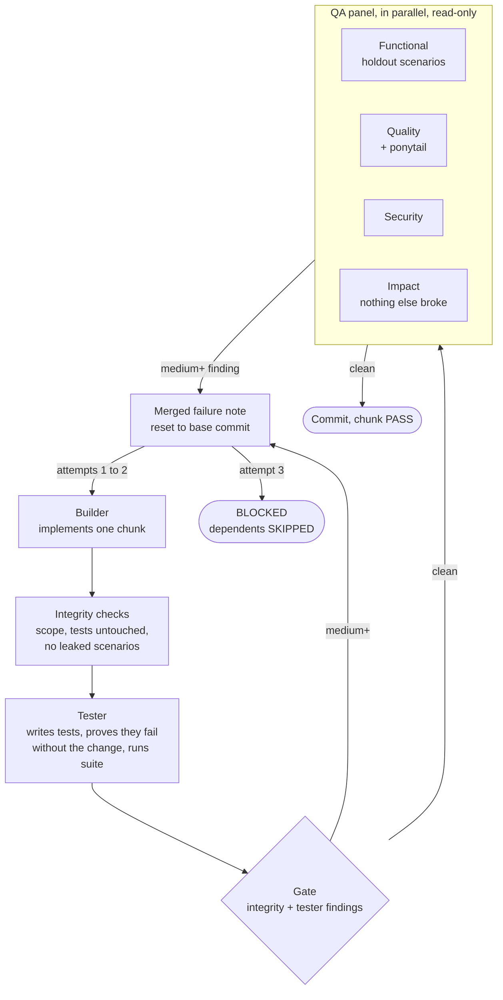
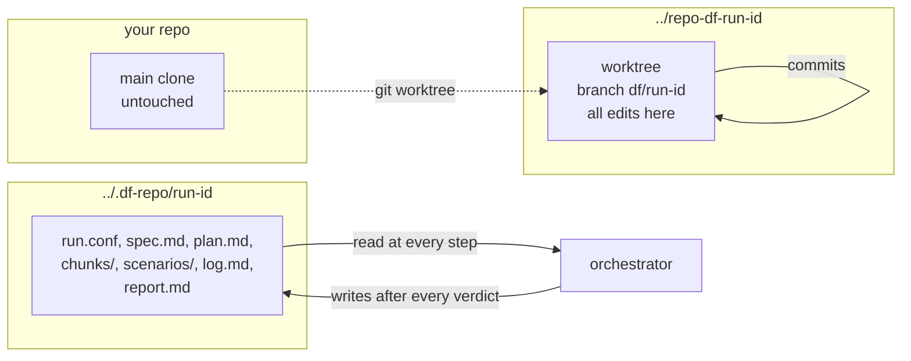

# Dark Factory

Spec in, tested software out. Give it an idea, PRD, feature request or bug report. It asks you
only what the repo cannot answer, you sign off once, then a team of subagents builds, tests and
QAs in a loop with nobody in the middle. You get a branch and a report. It never pushes,
merges or opens a PR.

Status: v0.1, private. Claude Code only. macOS, Linux and WSL.

## Install

```bash
claude plugin marketplace add /path/to/dark-factory      # or owner/repo once published
claude plugin install dark-factory@dark-factory --scope project
```

Try without installing: `claude --plugin-dir /path/to/dark-factory`.

## Use

```
/dark-factory <idea, PRD, ticket text, bug report, or a path>
/dark-factory list | status [run-id] | resume [run-id] | clean <run-id>
```

`resume` works from a brand-new session in the same repo. All state is on disk.

## How it works

You are involved at two points only: answering questions, and one sign-off.

```mermaid
flowchart LR
    A([Your request]) --> R[Route<br/>bugfix / feature / build]
    R --> F[Refine<br/>gap questions]
    F --> P[Plan<br/>chunks + QA scenarios]
    P --> PF[Preflight<br/>deps, commands, baseline]
    PF --> S{{Sign-off<br/>approve / amend / abort}}
    S --> L[[Loop per chunk<br/>build, test, QA]]
    L --> I[Integrate<br/>whole-branch review]
    I --> O([Branch + report.md])

    classDef you fill:#fde68a,stroke:#b45309,color:#000
    class F,S you
```



Yellow steps are the only ones that ask you anything. Everything after sign-off is unattended.

### The loop, per chunk

A chunk gets three attempts. Anything **medium or above** from any reviewer blocks it and is
fed back as one merged note to the next attempt. A blocked chunk gets one run-wide re-plan
before its dependents are skipped.



### State and resume



The orchestrator keeps nothing in memory. A crash, expired login or closed laptop costs at
most the attempt in flight.

## Tracks

| Track | Picked when | Shape |
|---|---|---|
| `bugfix` | something that should work does not | failing reproduction test first, then the smallest fix at the shared choke point |
| `feature` | new behaviour in an existing codebase | thinnest end-to-end slice first, reuse existing patterns |
| `build` | empty repo or a new application | walking skeleton first, then vertical feature slices |

The router decides on intent, not wording.

## What it asks of you

- Answers to one batch of at most 8 refine questions, each with a proposed default.
- One sign-off screen: scope, chunks, commands it will run, budgets.
- Permission to write the hidden state dir and run the build and test commands preflight
  lists. A later denial pauses the run as `waiting_permission`; `status` says what to allow.

## Safety

- All edits happen in a git worktree on branch `df/<run-id>`. Your working tree is untouched.
- A guard hook blocks `git push`, recursive deletes outside the worktree, pipe-to-shell and
  migrations against non-run databases while a run is live. A seat belt, not a sandbox.
- Request text, repo files and test output are data. Instructions found in them are reported,
  not followed.
- Holdout scenarios are hidden from the builder by instruction and checked with canary tokens.
  A soft barrier.

## Evidence and limits

Run against real issues in ten codebases (Python, JavaScript, Go, Rust; 3k to 98k lines; bug,
feature and build tracks), each graded by a hidden upstream or black-box test the factory never
saw. Results, including every failure and what was changed because of it, are in
`docs/evaluation.md` and `docs/field-test.md`. Scenario review is in `docs/battle-test.md`,
what was run live in `docs/acceptance.md`.

No guarantee of correct output, no sandbox, prompt injection mitigated and not solved, native
Windows unsupported, each live scenario run once, token cost not measured.

## Development

```bash
bash tests/run.sh
```

`scripts/df` and the hook are covered by bash tests; the prompts are linted structurally and
exercised by `fixtures/`. Design: `docs/design.md`. The product name is decided before this
goes public.
