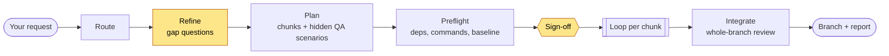
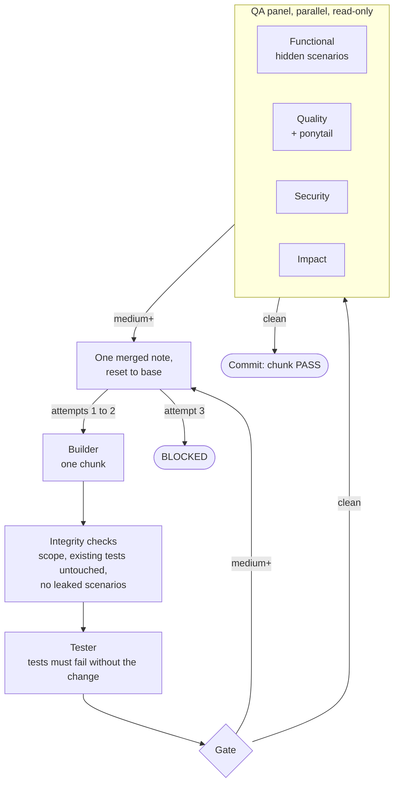

# Dark Factory

Give it a bug report, feature request, PRD or an idea. It asks only what the repo can't
answer, you sign off once, then a team of subagents builds, tests and QAs in a loop with nobody
in the middle. You get a git branch and a report. It never pushes, merges or opens a PR.

Claude Code plugin. v0.1, private. macOS, Linux, WSL.

## Install

```bash
claude plugin marketplace add /path/to/dark-factory      # or owner/repo once published
claude plugin install dark-factory@dark-factory --scope project
```

Try without installing: `claude --plugin-dir /path/to/dark-factory`.

## Use

```
/dark-factory <idea, PRD, ticket text, bug report, or a path>
/dark-factory list | status [run-id] | resume [run-id] | clean <run-id>
```

You answer one batch of questions (at most 8, each with a default) and approve once. `resume`
works from a new session: all state is on disk.

## What you get

- **Routed work.** `bugfix`, `feature` or `build` is picked for you and changes how it plans.
- **A branch `df/<run-id>`** in a separate git worktree, one commit per passing chunk.
- **`report.md`:** what was built, what was left (with severity), assumptions, and one plain
  line saying whether the branch is green. A bugfix that changed no source says **NOT FIXED**.
- **Hands-off QA.** Four parallel read-only reviewers, medium-or-above findings block.
- **Resume** after a crash, closed laptop or expired login, losing at most one attempt.

## How it works



Yellow is where you are asked something. Everything after sign-off is unattended.

Each chunk gets up to three attempts:



- The planner and the QA author work from the spec independently, so the tests can't be shaped
  by the implementation.
- The orchestrator keeps nothing in memory. Run state lives in `../.df-<repo>/<run-id>/`.
- A guard hook blocks `git push`, deletes outside the worktree and pipe-to-shell during a run.
  A seat belt, not a sandbox.

## Evidence

Run on eight real codebases (nine issues) plus two specs built from scratch, across Python, JavaScript, Go and
Rust (3k to 98k lines; bug, feature and build tracks), each graded by a hidden test the factory
never saw. One run each; one task did not finish. Every failure
and what changed because of it is in `docs/evaluation.md` and `docs/field-test.md`.

No guarantee of correct output, no sandbox, prompt injection mitigated and not solved, native
Windows unsupported, each live scenario run once, token cost not measured.

## Development

```bash
bash tests/run.sh
```

Design: `docs/design.md`. Product name is decided before this goes public.
